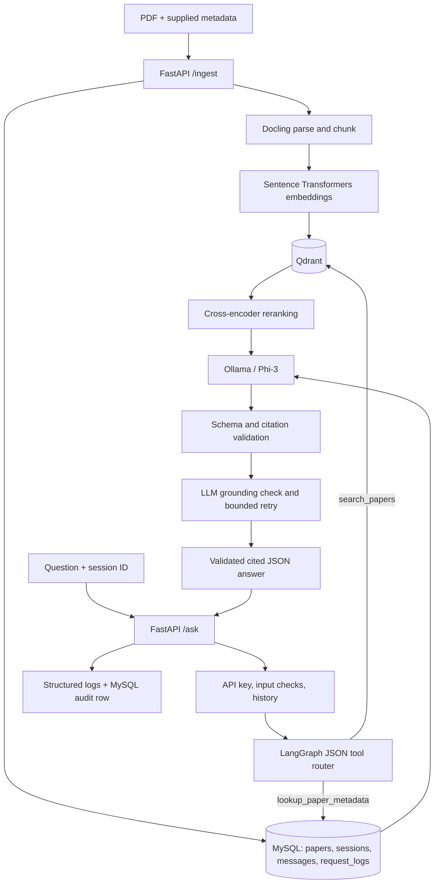

# Autonomous Research Agent

A local-first research assistant that ingests academic PDFs and answers questions
from retrieved passages. The API combines PDF parsing, dense vector retrieval,
cross-encoder reranking, structured local-model outputs, and a persisted
conversation workflow.

## Architecture



The model can choose only between `search_papers` and
`lookup_paper_metadata`. Search results are placed in an escaped, explicitly
untrusted block. Tool names are validated, and metadata lookups use SQLAlchemy
expressions rather than model-generated SQL.

## Requirements

- Python 3.11+
- Docker Desktop with Docker Compose
- Ollama installed on the host
- Enough disk space for Python dependencies and the embedding/reranker models

The Docker Compose runtime hosts the API, MySQL, and Qdrant. Ollama remains on
the host and is reached from the API container at `host.docker.internal`.

## Setup

1. Copy `.env.example` to `.env`.
2. Set `API_KEY` to a unique random secret of at least 32 characters. Change the
   local MySQL passwords before exposing the services beyond your machine.
3. Start the local Phi-3 model on the host:

   ```powershell
   ollama pull phi3
   ollama serve
   ```

4. Start the containers:

   ```powershell
   docker compose up --build
   ```

5. Open [http://localhost:8000/docs](http://localhost:8000/docs). Authenticated
   endpoints require an `X-API-Key` header with the value from `.env`. The
   health endpoint is available at `GET /health`.

The first API startup creates the declared MySQL tables. The first ingestion
downloads/loads the Docling, embedding, and cross-encoder model assets; the
initial load can take several minutes.

## API

### Ingest a paper

Supply title, comma-separated authors, publication year, and a PDF. Metadata is
provided explicitly rather than guessed from the document.

```powershell
curl.exe -X POST "http://localhost:8000/ingest" `
  -H "X-API-Key: $env:API_KEY" `
  -F "title=Example Research Paper" `
  -F "authors=First Author,Second Author" `
  -F "year=2024" `
  -F "file=@data/sample_paper.pdf;type=application/pdf"
```

The response includes a `paper_id` and the number of indexed chunks.

### Ask a question

```powershell
curl.exe -X POST "http://localhost:8000/ask" `
  -H "X-API-Key: $env:API_KEY" `
  -H "Content-Type: application/json" `
  -d '{"question":"Explain the paper'\''s method in simple terms"}'
```

Pass the returned `session_id` on later requests to load recent conversation
messages and ask follow-ups:

```json
{
  "session_id": "returned-session-uuid",
  "question": "Explain that paper's method in simpler words"
}
```

Answers include a validated answer string, citations, a `grounded` boolean,
selected tool, and generation attempt count. Citations must match retrieved
paper/chunk/page metadata. A grounding check may retry generation up to three
times; it is an LLM-based heuristic, not a correctness guarantee.

### Read conversation history

```powershell
curl.exe "http://localhost:8000/history/returned-session-uuid" `
  -H "X-API-Key: $env:API_KEY"
```

## Local development and tests

```powershell
python -m venv .venv
.\.venv\Scripts\Activate.ps1
python -m pip install -r requirements-test.txt
python -m pytest tests -q
```

The `requirements-test.txt` set avoids downloading the large PDF parser and
machine-learning runtimes when running unit tests. Install `requirements-dev.txt`
when you also need the full PDF ingestion and local retrieval stack. GitHub
Actions runs this unit-test set on pushes and pull requests.

## Evaluation

The sample evaluation set contains 26 questions grounded in
[`data/sample_paper.pdf`](./data/sample_paper.pdf). To run it, start the local
services, ingest the sample paper, then pass the returned paper UUID:

```powershell
python eval\run_eval.py --paper-id <paper-uuid>
```

The script writes detailed per-question results to `eval/results.json` (ignored
by Git) and reports:

- **Retrieval hit rate:** the fraction of questions whose expected evidence
  terms appear together in at least one retrieved chunk.
- **Grounded-answer rate:** the fraction of answers accepted by the model-based
  grounding checker.
- **Average latency:** mean end-to-end response time per question.

**Evaluation results have not yet been measured.** Run the evaluation against
the local services before reporting any numbers; do not treat the expected
answers or this metric definition as benchmark results. Retrieval hit rate here
is a project-specific evidence check, not a standard Recall@k score.

## Current scope and limitations

- This is a single-paper PDF ingestion and local question-answering workflow;
  it is not a web-search agent.
- Page citations are included only when Docling exposes page provenance for a
  chunk. Otherwise the citation uses the chunk ID.
- Grounding is judged by the same configured model family and can be wrong.
- Prompt phrase checks are a basic safeguard, not a complete prompt-injection
  defense. Retrieved document text must still be treated as untrusted.
- Database schema creation uses SQLAlchemy `create_all`; this prototype does
  not include a versioned migration system.
- Automated unit/API tests use fakes and SQLite where applicable. A real
  end-to-end Compose/MySQL/Qdrant/Ollama run is still needed to validate a fresh
  deployment.

## Project layout

```text
app/
  agent/       LangGraph workflow, structured outputs, conversation memory
  api/         FastAPI routes, authentication, request audit logging
  db/          SQLAlchemy models, async engine, repositories
  ingestion/   Docling PDF parsing and chunking
  security/    User input safeguards
  tools/       Qdrant retrieval, reranking, metadata/search tools
eval/          Sample-paper questions and evaluation runner
tests/         Unit and API tests
docker/        API Dockerfile
```
